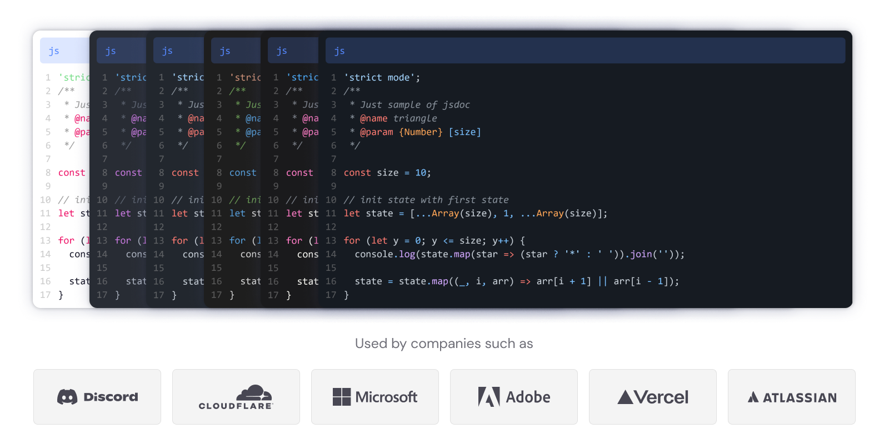

# speed-highlight

[](https://www.npmjs.com/package/@speed-highlight/core) [](https://www.npmjs.com/package/@speed-highlight/core)

A tiny, fast, simple syntax highlighter for the web and the terminal in JavaScript

- **Tiny** (~1.5 kB gzipped core, ~1 kB gzipped per language)
- **Fast** (generally outperforms Prism and highlight.js, see the [benchmark](#benchmark))
- **Simple** (zero dependencies)

[**Playground**](https://speed-highlight.github.io)



<!-- AUTOGENERATED:TOC:START (run `npm run build` to regenerate) -->
* [Quick start](#quick-start)
* [How it works](#how-it-works)
* [Comparison](#comparison)
* [Web usage](#web-usage)
	* [In a component](#in-a-component)
	* [On a plain page](#on-a-plain-page)
	* [Detect the language](#detect-the-language)
	* [Control loading and bundling](#control-loading-and-bundling)
	* [CDN (no build step)](#cdn-no-build-step)
* [Terminal usage](#terminal-usage)
* [API](#api)
* [Languages](#languages)
* [Themes](#themes)
* [Custom languages](#custom-languages)
* [Custom themes](#custom-themes)
* [Migrating from v1](#migrating-from-v1)
* [Benchmark](#benchmark)
<!-- AUTOGENERATED:TOC:END -->

## Quick start

```bash
npm i @speed-highlight/core
```

In a terminal:

```js
import { highlightANSI } from '@speed-highlight/core';
import theme from '@speed-highlight/core/themes/default.js';

console.log(await highlightANSI('console.log("hello")', 'js', theme));
```

In React (`highlightHTML` is async, languages load on first use; the effect drops stale results):

```jsx
import { useEffect, useState } from 'react';
import { highlightHTML } from '@speed-highlight/core';
import '@speed-highlight/core/themes/default.css';

export function Code({ code, lang }) {
	const [html, setHtml] = useState('');
	useEffect(() => {
		let stale = false;
		highlightHTML(code, lang).then(result => { if (!stale) setHtml(result); });
		return () => { stale = true; };
	}, [code, lang]);

	return <div className={`shj-lang-${lang} shj-block`} dangerouslySetInnerHTML={{ __html: html }} />;
}
```

## How it works

The tokenizer runs a language's regex rules and emits typed tokens (`kwd`, `str`, `cmnt`, ...). Each token becomes a `<span class="shj-syn-kwd">` on the web, an ANSI escape code in the terminal. A theme colors those names with CSS or a token-to-escape map, so it stays under 1 kB and a custom one is a few lines.

## Comparison

Highlighters trade size for fidelity: TextMate engines (Shiki, starry-night) are the most faithful and the heaviest, mature regex engines (highlight.js, Prism) sit in the middle, lightweight regex tokenizers (speed-highlight, sugar-high) are the smallest and approximate exotic syntax.

| | Core (gzip) | Per language (gzip) | Languages | Grammar model | Terminal | Status | Choose it for |
| --- | --- | --- | --- | --- | --- | --- | --- |
| speed-highlight | 1.5 kB | 0.07–1.6 kB | 34 | lightweight regex | ✅ built in | ✅ v2 (this repo) | runtime highlighting where size and startup matter |
| [sugar-high](https://github.com/huozhi/sugar-high) | 1.7 kB | 0.18–2.9 kB | 25 | lightweight regex | ❌ | ✅ v2.0.0 | CSS-variable theming, JSX/TSX-aware JavaScript |
| [Prism](https://prismjs.com) | 3.1 kB | 0.3–3 kB | ~290 | mature regex | ❌ | ⚠️ v1.30.0, frozen since Mar 2025 (v2 rewrite) | its plugin ecosystem |
| [highlight.js](https://highlightjs.org) | 8.3 kB | 0.3–2.5 kB | ~190 | mature regex | ❌ (via wrappers) | ✅ v11.11 (Jun 2026) | broad auto-detection and rare languages |
| [Shiki](https://shiki.style) | 35 kB + engine: 145 kB WASM or 20 kB JS | 5–16 kB | ~220 | TextMate (VS Code) | ✅ via `@shikijs/cli` | ✅ v4.4, very active | highest fidelity (the same grammars as VS Code); zero client JS when run at build time |
| [starry-night](https://github.com/wooorm/starry-night) | 185 kB incl. WASM | 3–25 kB | 600+ | TextMate (GitHub) | ❌ | ✅ active | GitHub-identical rendering in Node |

- Sizes: min+gzip of the installed packages at the versions shown; per-language is the range over the benchmark corpus; starry-night from its README.
- Wrappers reuse an engine and its numbers: lowlight and refractor (highlight.js, Prism), rehype-pretty-code and bright (Shiki), [emphasize](https://github.com/wooorm/emphasize) and [cli-highlight](https://github.com/felixfbecker/cli-highlight) (highlight.js to ANSI).
- Build-time highlighting where bytes do not matter: use Shiki. At runtime, speed-highlight with all 34 of its grammars bundled in one file weighs 9.0 kB gzip, about the size of highlight.js's core without any grammar.

## Web usage

### In a component

Render the string `highlightHTML` returns, as in the [quick start](#quick-start); `highlightElement` on a node the framework owns is undone by its next render. The output is HTML-escaped, safe for untrusted code. Components for Vue, Svelte and Angular: [examples](examples).

### On a plain page

Mark code blocks with a `shj-lang-*` class and call `highlightAll` once:

```html
<div class="shj-lang-js">console.log('hello')</div>
<code class="shj-lang-js">inline code</code>

<script type="module">
	import { highlightAll } from '@speed-highlight/core';
	highlightAll();
</script>
```

Blocks are a `<div>`, so the line-number gutter fits inside.

`highlightElement` highlights one element: a `code` inline, anything else as a block, unless `block` says otherwise. It sets `data-lang` for a theme header (`content: attr(data-lang)`):

```js
import { highlightElement } from '@speed-highlight/core';

await highlightElement(element, 'js', { block: true, showLineNumbers: true });
```

### Detect the language

Detection is a separate ~1 kB import. It recognizes about 20 common languages and returns `'plain'` when unsure:

```js
import { highlightElement } from '@speed-highlight/core';
import { detectLanguage } from '@speed-highlight/core/detect';

element.textContent = code;
await highlightElement(element, detectLanguage(code));
```

### Control loading and bundling

Languages load on first use through a loader. `setLoader` replaces it, to add languages or limit what the bundler includes; an unknown name renders as plain text:

```js
import { setLoader, defaultLoader } from '@speed-highlight/core';

// add custom languages on top of the bundled ones
setLoader(name => customs[name] ?? defaultLoader(name));

// or allow only the languages your bundler can code-split
setLoader(name => ({
	js: () => import('@speed-highlight/core/languages/js.js'),
	css: () => import('@speed-highlight/core/languages/css.js'),
})[name]?.());
```

For full tree-shaking, `tokenizeWith` takes every language from the caller, the sub-languages too (`html` uses `css` and `js`, `js` uses `jsdoc`, `todo` and `regex`). A missing one is left without inner highlighting:

```js
import { tokenizeWith } from '@speed-highlight/core/tokenize';
import { html, css, js, jsdoc, todo, regex } from '@speed-highlight/core/languages';

tokenizeWith(code, html, (str, type) => { /* ... */ }, { languages: { css, js, jsdoc, todo, regex } });
```

> [!NOTE]
> `highlightHTML` and `tokenizeWith` never touch the DOM: they also run server-side or in a web worker.

### CDN (no build step)

```html
<link rel="stylesheet" href="https://cdn.jsdelivr.net/npm/@speed-highlight/core@2/dist/themes/default.css">
<script type="module">
	import { highlightAll } from 'https://cdn.jsdelivr.net/npm/@speed-highlight/core@2/dist/index.js';
	highlightAll();
</script>
```

## Terminal usage

`highlightANSI` returns a string ready to print. It takes a theme: a bundled one from `themes/*.js`, or your own (below):

```js
import { highlightANSI } from '@speed-highlight/core';
import theme from '@speed-highlight/core/themes/atom-dark.js';

console.log(await highlightANSI(code, 'js', theme));
```

A terminal theme maps token names to ANSI escapes, from the `termcolor` helpers or raw escapes:

```js
import * as col from '@speed-highlight/core/themes/termcolor.js';

export default {
	kwd: col.red,
	str: col.green,
	cmnt: col.gray,
};
```

Deno: import with `npm:`, no install:

```js
import { highlightANSI } from 'npm:@speed-highlight/core';
import theme from 'npm:@speed-highlight/core/themes/default.js';

console.log(await highlightANSI('console.log("hello")', 'js', theme));
```

## API

Give a language name and the main entry loads its grammar, so its functions are async. Import the grammars yourself and `tokenizeWith` from `/tokenize` runs synchronously, and the bundler keeps only what you import. Every entry ships its TypeScript declarations.

| Entry | Export | Description |
| --- | --- | --- |
| [`@speed-highlight/core`](src/index.js) | `highlightAll(opt?)` | Highlight every element with a `shj-lang-*` class |
| | `highlightElement(elm, lang?, opt?)` | Highlight one element, language from its class by default |
| | `highlightHTML(src, lang, opt?)` | Highlight a string, resolves to an HTML string |
| | `highlightANSI(src, lang, theme)` | Highlight a string, resolves to an ANSI string for terminals |
| | `tokenize(src, lang, onToken)` | Loader-based tokenizer, calls `onToken(text, type)` |
| | `setLoader(loader)` / `defaultLoader` | Replace or compose how language names are resolved |
| [`.../detect`](src/detect.js) | `detectLanguage(code)` | Guess the language, `'plain'` when unsure |
| [`.../tokenize`](src/tokenize.js) | `tokenizeWith(src, lang, onToken, opt?)`, `tokenizer` | Synchronous tokenizer (and its generator), languages given by the caller |
| [`.../languages`](src/languages/) | one named export per language | Grammars, import only what you need |
| [`.../themes/*.css`](src/themes/) | | Web themes |
| [`.../themes/*.js`](src/themes/) | | Terminal themes, plus `termcolor.js` helpers |

- `lang`: a name (`'js'`) or a grammar object.
- `opt`: `{ block?: boolean, showLineNumbers?: boolean }`. Line numbers are opt-in. `block` defaults to `true`; `highlightElement` and `highlightAll` read it from the element instead (`code` is inline, anything else a block).

## Languages

<!-- AUTOGENERATED:LANGUAGES:START (run `npm run build` to regenerate) -->
| Name | [CSS Class](#web-usage) | Support | Detection | Size (gzip, 14.5 kB total) |
| --- | --- | --- | --- | --- |
| Assembly | `shj-lang-asm` |  | ✅ | [`194 B`](src/languages/asm.js) |
| Bash | `shj-lang-bash` |  | ✅ | [`430 B`](src/languages/bash.js) |
| Brainfuck | `shj-lang-bf` | increment, operator, print, comment | ❌ | [`137 B`](src/languages/bf.js) |
| C | `shj-lang-c` |  | ✅ | [`429 B`](src/languages/c.js) |
| CSS | `shj-lang-css` | comment, str, selector, units, function, ... | ✅ | [`332 B`](src/languages/css.js) |
| CSV | `shj-lang-csv` | punctuation, ... | ❌ | [`96 B`](src/languages/csv.js) |
| Diff | `shj-lang-diff` |  | ✅ | [`144 B`](src/languages/diff.js) |
| Dockerfile | `shj-lang-docker` |  | ✅ | [`566 B`](src/languages/docker.js) |
| Git | `shj-lang-git` | comment, insert, deleted, string, ... | ❌ | [`222 B`](src/languages/git.js) |
| Go | `shj-lang-go` |  | ✅ | [`329 B`](src/languages/go.js) |
| HTML | `shj-lang-html` | inline style and event handlers | ✅ | [`769 B`](src/languages/html.js) |
| HTTP | `shj-lang-http` | keywork, string, punctuation, variable, version | ✅ | [`986 B`](src/languages/http.js) |
| INI | `shj-lang-ini` |  | ❌ | [`158 B`](src/languages/ini.js) |
| Java | `shj-lang-java` |  | ✅ | [`457 B`](src/languages/java.js) |
| JavaScript | `shj-lang-js` | basic syntax, regex, jsdoc, json, template literals | ⛔ reported as TypeScript | [`820 B`](src/languages/js.js) |
| JSDoc | `shj-lang-jsdoc` |  | ❌ | [`251 B`](src/languages/jsdoc.js) |
| JSON | `shj-lang-json` | string, number, bool, ... | ❌ | [`172 B`](src/languages/json.js) |
| LeanPub Markdown | `shj-lang-leanpub-md` |  | ❌ | [`1.2 kB`](src/languages/leanpub-md.js) |
| Log | `shj-lang-log` | number, string, comment, errors | ❌ | [`223 B`](src/languages/log.js) |
| Lua | `shj-lang-lua` |  | ✅ | [`273 B`](src/languages/lua.js) |
| Makefile | `shj-lang-make` |  | ✅ | [`223 B`](src/languages/make.js) |
| Markdown | `shj-lang-md` |  | ✅ | [`1.1 kB`](src/languages/md.js) |
| Perl | `shj-lang-pl` |  | ✅ | [`329 B`](src/languages/pl.js) |
| Plain text | `shj-lang-plain` |  | ❌ | [`71 B`](src/languages/plain.js) |
| Python | `shj-lang-py` |  | ✅ | [`416 B`](src/languages/py.js) |
| Regex | `shj-lang-regex` | count, set, ... | ❌ | [`176 B`](src/languages/regex.js) |
| Rust | `shj-lang-rs` |  | ✅ | [`414 B`](src/languages/rs.js) |
| SQL | `shj-lang-sql` | number, string, function, ... | ✅ | [`1.7 kB`](src/languages/sql.js) |
| TODO | `shj-lang-todo` |  | ❌ | [`185 B`](src/languages/todo.js) |
| TOML | `shj-lang-toml` | comment, table, string, bool, variable | ❌ | [`236 B`](src/languages/toml.js) |
| TypeScript | `shj-lang-ts` | js syntax, ts keyword, types | ✅ | [`911 B`](src/languages/ts.js) |
| URI | `shj-lang-uri` |  | ✅ | [`176 B`](src/languages/uri.js) |
| XML | `shj-lang-xml` |  | ✅ | [`530 B`](src/languages/xml.js) |
| YAML | `shj-lang-yaml` | comment, numbers, variable, string, bool | ✅ | [`208 B`](src/languages/yaml.js) |
<!-- AUTOGENERATED:LANGUAGES:END -->

## Themes

<!-- AUTOGENERATED:THEMES:START (run `npm run build` to regenerate) -->
| Name | Terminal (gzip) | Web (gzip) |
| --- | --- | --- |
| `default` | ✅ [`174 B`](src/themes/default.js) | ✅ [`600 B`](src/themes/default.css) |
| `atom-dark` | ✅ [`174 B`](src/themes/atom-dark.js) | ✅ [`697 B`](src/themes/atom-dark.css) |
| `catppuccin-frappe` | ❌ | ✅ [`691 B`](src/themes/catppuccin-frappe.css) |
| `catppuccin-latte` | ❌ | ✅ [`691 B`](src/themes/catppuccin-latte.css) |
| `catppuccin-macchiato` | ❌ | ✅ [`691 B`](src/themes/catppuccin-macchiato.css) |
| `catppuccin-mocha` | ❌ | ✅ [`689 B`](src/themes/catppuccin-mocha.css) |
| `dark` | ❌ | ✅ [`692 B`](src/themes/dark.css) |
| `dracula` | ❌ | ✅ [`686 B`](src/themes/dracula.css) |
| `github-dark` | ❌ | ✅ [`689 B`](src/themes/github-dark.css) |
| `github-dim` | ❌ | ✅ [`697 B`](src/themes/github-dim.css) |
| `github-light` | ❌ | ✅ [`667 B`](src/themes/github-light.css) |
| `visual-studio-dark` | ❌ | ✅ [`691 B`](src/themes/visual-studio-dark.css) |
<!-- AUTOGENERATED:THEMES:END -->

## Custom languages

A language is an array of rules. Each regex needs the global flag. The earliest match wins; ties go to the earlier rule:

```js
export default [
	{ match: /\/\/.*/g, type: 'cmnt' },
	{ expand: 'str' },
	{ expand: 'num' },
	{ match: /\b(if|else|for|while|return)\b/g, type: 'kwd' },
];
```

- `{ match, type }` tags what the regex matches with a token type
- `{ expand }` reuses a shared pattern: `'num'`, `'str'`, or `'strDouble'`
- `{ match, sub }` highlights the match with another language: a name, a grammar, or a function `code => name | grammar`

Pass the grammar as `lang`, or name it by wrapping the loader: `setLoader(name => customs[name] ?? defaultLoader(name))`. Export `{ type, sub }` instead of an array to give unmatched text a token (see [`http.js`](src/languages/http.js)). To extend a language, spread it after your rules:

```js
import js from '@speed-highlight/core/languages/js.js';

export default [
	{ match: /\b(signal|effect)\b/g, type: 'func' },
	...js,
];
```

Token types:

| Token | Used for | | Token | Used for | | Token | Used for |
| --- | --- | --- | --- | --- | --- | --- | --- |
| `kwd` | keywords | | `type` | types | | `esc` | escape sequences |
| `str` | strings | | `class` | classes | | `section` | section delimiters |
| `num` | numbers | | `var` | variables | | `insert` | inserted parts (diff) |
| `cmnt` | comments | | `oper` | operators | | `deleted` | deleted parts (diff) |
| `func` | functions | | `bool` | booleans | | `err` | errors |

Missing a language? [Open an issue](https://github.com/speed-highlight/core/issues) or send a PR adding a file to [`src/languages/`](src/languages/).

## Custom themes

A web theme colors the token classes. Start from [`default.css`](src/themes/default.css):

```css
[class*="shj-lang-"] { color: #f8f8f2; background: #282a36; }
.shj-syn-kwd { color: #ff79c6; }
.shj-syn-str, .shj-syn-insert { color: #50fa7b; }
.shj-syn-cmnt { color: #6272a4; font-style: italic; }
.shj-numbers { color: #6272a4; }
```

Display classes: `.shj-inline` (inside `code`), `.shj-block`, `.shj-numbers` (gutter). Terminal themes: see [Terminal usage](#terminal-usage).

## Migrating from v1

| v1 | v2 |
| --- | --- |
| `highlightText(src, lang)` | `highlightHTML(src, lang)` |
| `printHighlight(src, lang)` from `/terminal` | `console.log(await highlightANSI(src, lang, theme))` |
| `setTheme('atom-dark')` | pass the theme: `highlightANSI(src, lang, theme)` |
| `loadLanguage(name, grammar)` | `setLoader(...)` or pass the grammar directly as `lang` |
| `@speed-highlight/core/terminal` entry | merged into `@speed-highlight/core` |
| `common.js` shared patterns | `{ expand: 'num' \| 'str' \| 'strDouble' }` built into the tokenizer |
| `{ hideLineNumbers: true }` | now the default, line numbers are opt-in with `{ showLineNumbers: true }` |
| `oneline` display mode | removed, a `div` is always a block |
| `highlightElement(elm, lang, mode, opt)` | the mode moved into the options: `highlightElement(elm, lang, { block })` |
| `shj-multiline` class | `shj-block` |

## Benchmark

<!-- AUTOGENERATED:BENCHMARK:START (run `npm run benchmark -- --write` to regenerate) -->
```rb
$ npm run benchmark
node v26.7.0, darwin arm64, Apple M4
corpus: js, css, json, md, sql, py, bash, tiled to 3 sizes (tiny (1 KB) / medium (16 KB) / huge (128 KB)), median of 9 trials per language, averaged across the corpus

                              tiny (1 KB)     medium (16 KB)      huge (128 KB)
speed-highlight         1,144,010 ops/min     74,720 ops/min      8,583 ops/min
prismjs                   655,152 ops/min     34,310 ops/min      2,575 ops/min
highlight.js              595,113 ops/min     48,666 ops/min      5,473 ops/min
sugar-high                238,406 ops/min     13,405 ops/min      1,376 ops/min
shiki (js engine)          89,925 ops/min      6,682 ops/min        841 ops/min

cold start (import + first highlight of test.js):
speed-highlight                    7.3 ms
prismjs                            8.6 ms
highlight.js                        19 ms
sugar-high                          18 ms
shiki (js engine)                  169 ms

speed-highlight per language (warm, median of 9 trials):
                              tiny (1 KB)     medium (16 KB)      huge (128 KB)
js                        666,642 ops/min     40,773 ops/min      4,704 ops/min
css                     1,006,895 ops/min     62,774 ops/min      7,284 ops/min
json                    1,964,840 ops/min    127,890 ops/min     15,057 ops/min
md                      1,080,739 ops/min     86,883 ops/min     10,453 ops/min
sql                     1,369,247 ops/min     88,513 ops/min     10,180 ops/min
py                        974,179 ops/min     56,165 ops/min      6,260 ops/min
bash                      945,526 ops/min     60,045 ops/min      6,141 ops/min
```
<!-- AUTOGENERATED:BENCHMARK:END -->

Every library highlights the same files ([`examples/languages/`](examples/languages/), tiled to each size) to an HTML string; one op is one file, the median of 9 trials in ops/min, with grammars preloaded. Cold start (import + first highlight) is measured once. Shiki does more work by design (see [Comparison](#comparison)).
